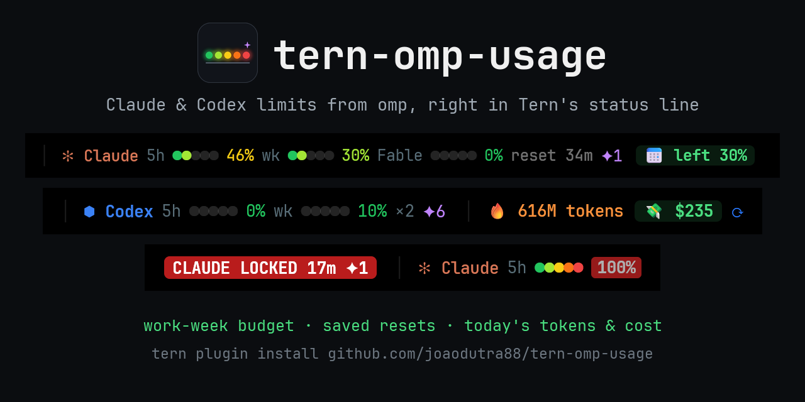
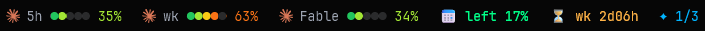

<div align="center">



[](https://github.com/joaodutra88/tern-omp-usage/actions/workflows/check.yml)
[](LICENSE)
[](https://github.com/joaodutra88/tern-omp-usage/stargazers)
[](https://github.com/joaodutra88/tern-omp-usage/releases/latest)

Un plugin de [Tern](https://stencil.so/tern) para usuarios de [omp](https://omp.sh). Sus widgets mantienen en la barra de widgets de Tern los límites de suscripción de Claude y Codex, el presupuesto de esta semana, tus reinicios guardados y los tokens, el costo y la velocidad de hoy. Haz clic en el costo de hoy para abrir un dashboard de los últimos 7 días, con todos los proveedores que omp registra.

**[Instalación](#instalación)** · **[Los widgets](#los-widgets)** · **[Configuración](#configuración)** · **[FAQ](#faq)** · **[Contribuir](#contribuir)**

[English](README.md) | [Português](README.pt-BR.md) | **Español** | [简体中文](README.zh-CN.md) | [日本語](README.ja.md)

El README en inglés es la referencia y prevalece si hay diferencias.



</div>

## Qué responde

Todo queda en la barra de widgets, así que las respuestas están en pantalla mientras trabajas:

- **¿Puedo permitirme una ejecución pesada hoy?** Un presupuesto de la semana laboral: cada día hábil desbloquea el 20% de la cuota semanal, y la parte de un feriado se traslada.
- **¿Cuánto costó hoy?** Tokens y costo a precio de API desde medianoche, de todos los proveedores que omp registra, con el total acumulado como gráfico opcional. El dashboard añade los últimos 7 días, este mes y el costo por modelo.
- **¿Tengo un reinicio guardado?** Reinicios guardados de límites de uso para Claude y Codex, cuántos puedes usar ahora, y un aviso emergente cuando uno se vuelve usable o está por expirar.
- **¿Cuándo me quedo sin cuota?** Al ritmo actual, cuánto falta para que se bloquee la ventana de 5h o la semanal, cuando eso ocurre antes de su reinicio. Un aviso emergente cuando una ventana llega al 80%, se bloquea o vuelve a liberarse.
- **¿Algo va mal?** Un widget que solo aparece cuando omp falla o desactiva un inicio de sesión.
- **Claude y Codex lado a lado**, ambos leídos a través de omp, sin nada nuevo que iniciar sesión.

## Los widgets

Colócalos con paleta › **Edit widgets…**, en el orden que quieras. Todos son texto; en el mismo editor el presupuesto puede pasar a barra y los tokens y el costo de hoy, a gráfico. Los colores siguen tu tema de Tern. Pasa el ratón sobre un widget para ver los detalles; un clic actualiza los límites, o abre el dashboard desde el presupuesto, los tokens, el costo y la velocidad. Un widget sin nada que mostrar se oculta.

| Widget | Se ve así | Significado |
|---|---|---|
| **Claude 5h**, **Claude wk**, **Claude Fable** | `5h ●●○○○ 40%` | Parte usada de la ventana, junto al icono del proveedor: cinco puntos se llenan del verde al rojo, y el porcentaje toma el color del último punto alcanzado, rojo desde el umbral de la insignia roja (80% salvo que lo cambies). `↑` cuando subió 3 puntos o más desde la última lectura, 5 minutos antes. Al 100% muestra `LOCKED` con el tiempo hasta que se libere. El tooltip tiene el reinicio y, para 5h y wk a partir del 50% de uso, cuándo se agota la ventana al ritmo actual. Fable solo aparece cuando tu plan lo incluye. |
| **Codex 5h**, **Codex wk** | `5h ●●○○○ 25%` | Proporción agotada de tus cuentas de Codex vinculadas, con los mismos puntos; el tooltip cuenta las cuentas. Oculto cuando omp no tiene ninguna cuenta de Codex. |
| **Work-week budget** | `📅 left 21%` | Cada día hábil (de lunes a viernes, salvo que lo cambies) de la ventana actual de 7 días desbloquea una parte igual de la cuota semanal, el 20% con cinco días. `left` es la cuota desbloqueada y aún no gastada; `over`, en rojo, significa que estás gastando por delante de la semana. |
| **Runs out** | `⏳ wk 2d16h` | Al ritmo promedio desde que se abrió una ventana de Claude, se agota en este tiempo, antes de su reinicio. Aparece a partir del 50% de uso. |
| **Saved resets** | `✦ 1/3` | Reinicios de límite de uso guardados, usables ahora / guardados (un solo número cuando todos son usables). El tooltip indica qué libera cada uno y cuándo expira. |
| **Tokens today**, **Cost today** | `🔥 56M`, `💸 $30` | Tokens y costo a precio de API desde la medianoche local, todos los proveedores, desde `omp stats`; el gráfico es el total acumulado. Las lecturas de caché cuentan como tokens, así que la mayor parte de este número es caché. |
| **Speed and cache** | `⚡ 79 tok/s · ♻ 99%` | Velocidad media de salida y tasa de aciertos de caché durante el último día de omp; el tooltip añade el tiempo hasta el primer token y la parte del costo de entrada que ahorró la caché. |
| **Problems** | `⚠ Codex off` | Solo cuando falló una llamada a `omp usage` u omp desactivó un inicio de sesión; el tooltip tiene la causa, sin el correo de la cuenta. |
| **Plugin update** | `⬆ 0.6.0` | Una versión más nueva de este plugin; haz clic para instalarla. |

Las alertas llegan como avisos emergentes: una ventana que alcanza el umbral de la insignia roja, se bloquea o vuelve a liberarse; un reinicio guardado que se vuelve usable o expira en menos de 2 días; un inicio de sesión que omp desactiva.

### Dashboard

**OMP usage: dashboard** (o un clic en el presupuesto, los tokens, el costo o la velocidad) abre un panel junto al que estás usando. Muestra hora por hora durante los últimos 7 días cada límite que omp registra (Claude, Codex, Gemini, xAI, OpenCode Go…), desde `omp usage --history`; el costo a precio de API de hoy, de los últimos 7 días y de este mes, con una barra por día; y el costo por modelo desde `omp stats`. Presiona `r` para volver a leerlo todo.

`omp stats` solo guarda alrededor de un día, así que el plugin conserva por su cuenta el total de cada día. La semana y el mes se van llenando a partir del día en que instalas la 0.4.0.

## Instalación

```sh
tern plugin install https://github.com/joaodutra88/tern-omp-usage
```

Necesitas `omp` con sesión iniciada en Anthropic y/o OpenAI Codex, para que `omp usage` funcione en una terminal. El plugin usa el omp que gestiona Tern (`%LOCALAPPDATA%\Tern\omp\bin\omp.exe` en Windows, `~/Library/Application Support/Tern/omp/bin/omp` en macOS) y recurre a `omp` en el `PATH`. Si el demonio de Tern no lo encuentra, define `OMP_USAGE_BIN` con la ruta completa.

Luego coloca los widgets que quieras: paleta › **Edit widgets…** (Tern 0.9.17 o posterior).

### Actualizaciones

Una vez al día el plugin revisa en GitHub si hay una versión más nueva. Cuando la hay, el widget **Plugin update** muestra un `⬆ 0.6.0` azul y un aviso emergente te lo dice una vez. Haz clic en él, o ejecuta **OMP usage: update to the latest version**, y el plugin se reinstala desde este repositorio (`tern plugin install … --force`). Tu configuración y tu `extras.luau` se conservan. Después de la actualización, un aviso emergente indica la nueva versión, y **OMP usage: what's new** abre sus notas de la versión.

Un checkout vinculado (`tern plugin link`) se actualiza con `git pull`. Para dejar de revisar, desactiva la parte `updates` (ver [Configuración](#configuración)) o define `OMP_USAGE_NO_UPDATE_CHECK=1`.

**¿Vienes de la 0.4.x?** La 0.5.0 saca el uso del widget **Plugin segments** y lo pasa a widgets propios, así que la barra queda vacía hasta que los coloques: paleta › **Edit widgets…**. El aviso emergente tras la actualización lo indica.

**¿Estás en la 0.3.x?** Esas versiones no revisan actualizaciones. Ejecuta una vez el comando de instalación de arriba con `--force`, y a partir de la 0.4.0 el plugin te avisa por sí mismo.

Para enterarte de las versiones también por correo electrónico, usa **Watch → Custom → Releases** en la parte superior de este repositorio.

### Instalar con tu agente de IA

Pega esto en omp, Claude Code, Codex o cualquier agente que pueda ejecutar comandos:

```text
Install the Tern plugin https://github.com/joaodutra88/tern-omp-usage for me.
1. Check `omp usage --json -p anthropic` (or `-p openai-codex`) works. If it doesn't, help me sign in with omp first.
2. Run `tern plugin install https://github.com/joaodutra88/tern-omp-usage`.
3. Run `tern plugin list --json` and confirm `omp-usage` has status "ready".
4. If it isn't ready, read the lines containing `omp-usage` in Tern's log
   (`%LOCALAPPDATA%\Tern\Logs\tern.log` on Windows) and the repo's AGENTS.md, then tell me what is wrong.
5. Help me place the plugin's widgets (palette › Edit widgets…) and explain what each one means, using the README.
```

## Qué ejecuta y qué toca

El plugin no lee credenciales. Ejecuta omp y hace una única petición de red propia:

| Comando | Cuándo |
|---|---|
| `omp usage --json -p anthropic` | Cada 5 min. El endpoint de uso de Anthropic responde 429 por debajo de unos 5 min. |
| `omp usage --json -p openai-codex` | Cada 5 min |
| `omp stats --json` | Cada 5 min |
| `omp usage --history --json --days 7`, luego `omp stats --json` | Al abrir el dashboard y al presionar `r` en él |
| `omp usage invalidate` | Al hacer clic en un widget de límite, para saltarse la caché de omp |
| `GET api.github.com/repos/joaodutra88/tern-omp-usage/releases/latest` | Una vez al día por máquina, sin token; se desactiva con la parte `updates` o `OMP_USAGE_NO_UPDATE_CHECK=1` |
| `tern plugin install https://github.com/joaodutra88/tern-omp-usage --force` | Solo cuando haces clic en `⬆` o ejecutas el comando de actualización |

La configuración, los tokens y el costo de cada día (para el dashboard), los reinicios guardados de los que ya se avisó, la última versión vista y una copia de tu `extras.luau` (hecha antes de una actualización) se guardan en la carpeta de datos del plugin (`tern.kv`), en ningún otro lugar. Un widget solo lee los valores en caché que dejan esas llamadas, porque Tern le da 4 ms a su renderizado.

## Configuración

Abre la paleta de comandos y escribe `OMP usage`. La configuración se guarda en la carpeta de datos del plugin, así que una actualización o una reinstalación la conserva.

| Comando | Qué hace |
|---|---|
| **OMP usage: show or hide a part…** | Escribe una parte para activarla o desactivarla: `alerts` (los avisos emergentes) o `updates` (la revisión diaria de versiones). Lo que muestra la barra depende de los widgets que coloques. |
| **OMP usage: language…** | `en`, `pt-BR`, `es`, `zh-CN`, `ja`, `de` o `fr`. |
| **OMP usage: work days per week…** | Cuántos días, contados desde el lunes, desbloquean la cuota semanal. El valor por defecto `5` significa de lunes a viernes, 20% cada uno. |
| **OMP usage: red badge threshold…** | El porcentaje en el que una ventana se pone roja y salta su aviso de alerta (por defecto 80). |
| **OMP usage: reset settings** | Vuelve a los valores por defecto. |
| **OMP usage: check for updates** | Consulta GitHub ahora, incluso con `updates` desactivada. |
| **OMP usage: dashboard** | Abre el dashboard, o lo enfoca cuando esta ventana ya tiene uno. |
| **OMP usage: what's new** | Abre las notas de la versión que estás usando. |

Si el demonio de Tern no encuentra `omp`, define la variable de entorno `OMP_USAGE_BIN` con su ruta completa.

### En tu idioma

Cada palabra que muestra el plugin vive en `labels.luau`, una tabla por idioma. Para añadir uno, copia `en`, traduce los valores y abre un pull request. Las claves que un idioma no incluya recurren al inglés.

### Tus propios widgets

Si existe un archivo `extras.luau` junto a `window.luau`, el plugin lo carga. Git lo ignora, así que tus widgets personales nunca llegan al repositorio. Una actualización lo copia primero a la carpeta de datos del plugin, y el plugin carga esa copia cuando ya no está la que va junto a `window.luau`:

```luau
local M = {}
function M.init(hidden, every) end -- registrar widgets (tern.chrome.widget), comandos, temporizadores, CSS
function M.segments(out, pane) end -- opcional: segmentos para el widget Plugin segments de Tern
return M
```

## FAQ

**`tern plugin list` muestra el plugin como `disabled`.**
Tern desactiva un plugin que produce errores o cuyo renderizado de widget supera su presupuesto de tiempo. Ejecuta `tern plugin reload`, luego busca las líneas con `omp-usage` en el log de Tern (`%LOCALAPPDATA%\Tern\Logs\tern.log` en Windows) y abre un issue con ellas.

**Un widget de límite muestra `5h ?`.**
La última llamada a `omp usage` falló, y el widget **Problems** dice cuál. Comprueba que `omp usage --json -p anthropic` (o `-p openai-codex`) funciona en una terminal, e inicia sesión con omp si no funciona. Haz clic en el widget para reintentar.

**No aparece nada.**
Coloca los widgets: paleta › **Edit widgets…**. Si ya están colocados y siguen vacíos, es posible que el demonio de Tern no encuentre `omp`: define `OMP_USAGE_BIN` con su ruta completa y reinicia Tern.

**Los números van por detrás de claude.ai.**
Vienen del mismo endpoint de uso a través de omp, cada 5 minutos, porque Anthropic limita la frecuencia de las consultas más rápidas. Haz clic en un widget de límite para forzar una lectura nueva.

**¿Por qué el conteo de tokens de hoy es tan alto?**
Incluye las lecturas de caché, que son la mayor parte de la entrada de un agente. El costo es lo que esos tokens costarían a precio de API, no lo que cobra tu suscripción.

**¿Cómo lo actualizo?**
Haz clic en el `⬆` azul del widget **Plugin update** cuando aparezca, o ejecuta **OMP usage: update to the latest version**. A mano: `tern plugin install https://github.com/joaodutra88/tern-omp-usage --force`. Las versiones anteriores a la 0.4.0 no revisan actualizaciones, y en Windows la actualización de la 0.4.0 falla con "The process cannot access the file", así que actualízalas una vez a mano.

**¿Cómo lo desinstalo?**
`tern plugin remove omp-usage`.

## Contribuir

Es código abierto bajo MIT: úsalo, haz un fork, cámbialo, publícalo. Los issues y los pull requests están abiertos para todos.

- `python scripts/check.py` ejecuta la revisión de sintaxis, las pruebas unitarias y las revisiones de CSS y del manifiesto; `--integration` ejecuta el plugin completo en un Tern simulado, con respuestas grabadas de `omp` y de GitHub. CI ejecuta ambas en cada pull request, en Linux, Windows y macOS. Añade `--tern` para además recargar el plugin en tu Tern y leer su log.
- ¿Usas un agente de IA? Apúntalo a [AGENTS.md](AGENTS.md). Explica las reglas que se rompen fácilmente y cómo presentar un reporte de bug limpio para ti.
- Lo que está planeado, y lo que un cambio tiene que respetar: [ROADMAP.md](ROADMAP.md) (en inglés). Las ideas van a [Discussions](https://github.com/joaodutra88/tern-omp-usage/discussions); los issues marcados como **good first issue** son un buen punto de partida.
- Más en [CONTRIBUTING.md](CONTRIBUTING.md). Todos los participantes siguen el [Código de conducta](CODE_OF_CONDUCT.md); los problemas de seguridad se tratan según [SECURITY.md](SECURITY.md).

## Historial de estrellas

[](https://star-history.com/#joaodutra88/tern-omp-usage&Date)
