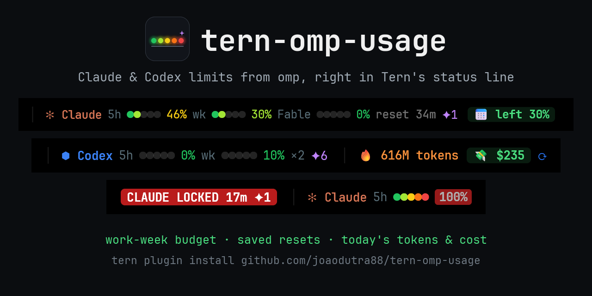
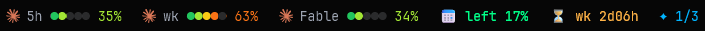

<div align="center">



[](https://github.com/joaodutra88/tern-omp-usage/actions/workflows/check.yml)
[](LICENSE)
[](https://github.com/joaodutra88/tern-omp-usage/stargazers)
[](https://github.com/joaodutra88/tern-omp-usage/releases/latest)

[omp](https://omp.sh) ユーザー向けの [Tern](https://stencil.so/tern) プラグインです。そのウィジェットが、Claude と Codex のサブスクリプション上限、今週の予算、保存済みのリセット、今日のトークン数・コスト・速度を Tern のウィジェットバーに表示し続けます。今日のコストをクリックすると、omp が追跡するすべてのプロバイダーを含む過去 7 日間のダッシュボードが開きます。

**[インストール](#インストール)** · **[ウィジェット](#ウィジェット)** · **[設定](#設定)** · **[FAQ](#faq)** · **[コントリビュート](#コントリビュート)**

[English](README.md) | [Português](README.pt-BR.md) | [Español](README.es.md) | [简体中文](README.zh-CN.md) | **日本語**

> この日本語版は参考訳です。英語版 README.md が正であり、内容が異なる場合は英語版が優先されます。



</div>

## わかること

すべてウィジェットバーに表示されるので、作業しながら答えを確認できます。

- **今日、重い処理を実行する余裕はあるか?** 週の作業日予算です。平日ごとに週間クォータの 20% が解放され、祝日分の枠は繰り越されます。
- **今日はいくらかかったか?** 深夜 0 時以降のトークン数と API 価格ベースのコストです。omp が追跡するすべてのプロバイダーが対象で、累計はグラフでも表示できます。ダッシュボードでは過去 7 日間、今月、モデル別のコストも確認できます。
- **保存済みのリセットはあるか?** Claude と Codex の保存済み使用量上限リセットと、今使える数を表示します。リセットが使えるようになったときや、期限切れが近いときにはトーストで通知します。
- **いつ使い切るか?** 現在のペースで、5h または週のウィンドウがロックされるまでの時間を、それがリセットより先に来る場合に表示します。ウィンドウが 80% に達したとき、ロックされたとき、再び解放されたときにはトーストで通知します。
- **何か問題はないか?** omp が失敗したときや、ログインをオフにしたときだけ表示されるウィジェットがあります。
- **Claude と Codex を並べて表示。** どちらも omp 経由で読み取るため、新たにサインインする必要はありません。

## ウィジェット

パレット › **Edit widgets…** で好きな順番に配置します。どれもテキストで表示され、同じエディタで予算はバーに、今日のトークン数とコストはグラフに切り替えられます。色は Tern のテーマに従います。ウィジェットにカーソルを合わせると詳細が表示されます。クリックすると上限を更新し、予算、トークン数、コスト、速度のウィジェットではダッシュボードが開きます。表示する内容がないウィジェットは自動的に隠れます。

| ウィジェット | 見た目 | 意味 |
|---|---|---|
| **Claude 5h**、**Claude wk**、**Claude Fable** | `5h ●●○○○ 40%` | プロバイダーのアイコンの横に表示されるウィンドウの使用率です。5 つのドットが緑から赤へと埋まり、パーセンテージは最後に達したドットの色になります。赤いバッジのしきい値(変更しない限り 80%)からは赤になります。5 分前の前回の読み取りから 3 ポイント以上上がると `↑` が付きます。100% になると `LOCKED` と解放までの時間を表示します。ツールチップにはリセット時刻と、5h と wk では使用率 50% 以上のとき、現在のペースでいつ使い切るかが表示されます。Fable はプランに含まれる場合のみ表示されます。 |
| **Codex 5h**、**Codex wk** | `5h ●●○○○ 25%` | 連携済み Codex アカウントのうち使い切った割合を、同じドットで表示します。ツールチップにアカウント数が表示されます。omp に Codex アカウントがない場合は表示されません。 |
| **Work-week budget** | `📅 left 21%` | 現在の 7 日間ウィンドウのうち、各作業日(変更しない限り月曜から金曜)が週間クォータの均等な割合を解放します。5 日なら 20% ずつです。`left` は解放済みでまだ使っていないクォータです。赤い `over` は、週のペースより先に使いすぎていることを意味します。 |
| **Runs out** | `⏳ wk 2d16h` | Claude のウィンドウが始まってからの平均ペースで進むと、リセットより前にこの時間で使い切ります。使用率 50% 以上で表示されます。 |
| **Saved resets** | `✦ 1/3` | 保存済みの使用量上限リセットで、今使える数 / 保存数です(すべて使える場合は 1 つの数字)。ツールチップには、それぞれが何をクリアし、いつ期限切れになるかが表示されます。 |
| **Tokens today**、**Cost today** | `🔥 56M`、`💸 $30` | 深夜 0 時(ローカル時間)以降のトークン数と API 価格ベースのコスト。すべてのプロバイダーが対象で、`omp stats` から取得します。グラフは累計です。キャッシュ読み取りもトークンに含まれるため、この数値の大部分はキャッシュです。 |
| **Speed and cache** | `⚡ 79 tok/s · ♻ 99%` | omp の直近 1 日の平均出力速度とキャッシュヒット率です。ツールチップには最初のトークンまでの時間と、キャッシュで節約した入力コストの割合も表示されます。 |
| **Problems** | `⚠ Codex off` | `omp usage` の呼び出しが失敗したとき、または omp がログインをオフにしたときだけ表示されます。ツールチップに原因が表示されます(アカウントのメールアドレスは含みません)。 |
| **Plugin update** | `⬆ 0.6.0` | このプラグインの新しいリリースです。クリックするとインストールします。 |

アラートはトーストで届きます: ウィンドウが赤いバッジのしきい値に達したとき、ロックされたとき、再び解放されたとき。保存済みリセットが使えるようになったとき、または 2 日以内に期限切れになるとき。omp がログインをオフにしたときです。

### ダッシュボード

**OMP usage: dashboard**(または予算、トークン数、コスト、速度のクリック)で、今いるペインの隣にペインが開きます。`omp usage --history` から取得した過去 7 日間の、omp が追跡するすべての上限(Claude、Codex、Gemini、xAI、OpenCode Go…)を 1 時間ごとに表示し、今日、過去 7 日間、今月の API 価格ベースのコストを日ごとのバー付きで、さらに `omp stats` からモデル別のコストを表示します。`r` を押すとすべて読み直します。

`omp stats` は約 1 日前までしか遡れないため、プラグインが各日の合計を自分で保存します。週と月の集計は、0.4.0 をインストールした日から埋まっていきます。

## インストール

```sh
tern plugin install https://github.com/joaodutra88/tern-omp-usage
```

Anthropic と / または OpenAI Codex に `omp` でサインインしておく必要があります。ターミナルで `omp usage` が動作することを確認してください。このプラグインは Tern が管理する omp (Windows では `%LOCALAPPDATA%\Tern\omp\bin\omp.exe`、macOS では `~/Library/Application Support/Tern/omp/bin/omp`) を使用し、見つからない場合は `PATH` 上の `omp` にフォールバックします。Tern のデーモンが見つけられない場合は、`OMP_USAGE_BIN` にフルパスを設定してください。

次に、使いたいウィジェットを配置します: パレット › **Edit widgets…**(Tern 0.9.17 以降)。

### アップデート

プラグインは 1 日に 1 回、GitHub に新しいリリースがあるか確認します。ある場合は、**Plugin update** ウィジェットに青い `⬆ 0.6.0` が表示され、トーストで一度だけ通知されます。それをクリックするか **OMP usage: update to the latest version** を実行すると、プラグインはこのリポジトリから自身を再インストールします(`tern plugin install … --force`)。設定と `extras.luau` は引き継がれます。アップデート後はトーストが新しいバージョンを知らせ、**OMP usage: what's new** でそのリリースノートが開きます。

リンクしたチェックアウト(`tern plugin link`)は、代わりに `git pull` で更新します。確認を止めるには、`updates` をオフにする([設定](#設定) を参照)か、`OMP_USAGE_NO_UPDATE_CHECK=1` を設定してください。

**0.4.x から移行しますか?** 0.5.0 では使用量の表示が **Plugin segments** ウィジェットから独立したウィジェットに移ったため、配置するまでバーは空のままです: パレット › **Edit widgets…**。アップデート後のトーストでもそのことを知らせます。

**0.3.x をお使いですか?** これらのバージョンには更新確認がありません。上のインストールコマンドを `--force` 付きで一度実行すれば、0.4.0 以降はプラグイン自身が知らせてくれます。

リリースをメールでも受け取るには、このリポジトリ上部の **Watch → Custom → Releases** を使ってください。

### AI エージェントでインストールする

omp、Claude Code、Codex、またはコマンドを実行できる任意のエージェントに、次を貼り付けます:

```text
Install the Tern plugin https://github.com/joaodutra88/tern-omp-usage for me.
1. Check `omp usage --json -p anthropic` (or `-p openai-codex`) works. If it doesn't, help me sign in with omp first.
2. Run `tern plugin install https://github.com/joaodutra88/tern-omp-usage`.
3. Run `tern plugin list --json` and confirm `omp-usage` has status "ready".
4. If it isn't ready, read the lines containing `omp-usage` in Tern's log
   (`%LOCALAPPDATA%\Tern\Logs\tern.log` on Windows) and the repo's AGENTS.md, then tell me what is wrong.
5. Help me place the plugin's widgets (palette › Edit widgets…) and explain what each one means, using the README.
```

## 実行するもの、触れるもの

このプラグインは認証情報を読み取りません。omp を実行するほか、独自のネットワークリクエストを 1 つだけ行います:

| コマンド | 実行タイミング |
|---|---|
| `omp usage --json -p anthropic` | 5 分ごと。Anthropic の使用量エンドポイントは約 5 分未満だと 429 を返します。 |
| `omp usage --json -p openai-codex` | 5 分ごと |
| `omp stats --json` | 5 分ごと |
| `omp usage --history --json --days 7`、続けて `omp stats --json` | ダッシュボードを開いたときと、その中で `r` を押したとき |
| `omp usage invalidate` | 上限のウィジェットをクリックしたとき。omp のキャッシュを回避するため |
| `GET api.github.com/repos/joaodutra88/tern-omp-usage/releases/latest` | マシンごとに 1 日 1 回、トークンなし。`updates` または `OMP_USAGE_NO_UPDATE_CHECK=1` でオフ |
| `tern plugin install https://github.com/joaodutra88/tern-omp-usage --force` | `⬆` をクリックするか、更新コマンドを実行したときのみ |

設定、各日のトークン数とコスト(ダッシュボード用)、通知済みの保存済みリセット、最後に確認したリリース、`extras.luau` のコピー(アップデート前に作成)は、プラグインのデータフォルダ(`tern.kv`)に保存され、それ以外の場所には書き込みません。Tern はウィジェットの描画に 4 ms しか与えないため、ウィジェットは上記の呼び出しでキャッシュされた値を読み取るだけです。

## 設定

コマンドパレットを開いて `OMP usage` と入力します。設定はプラグインのデータフォルダに保存されるため、アップデートや再インストールをしても保持されます。

| コマンド | 動作 |
|---|---|
| **OMP usage: show or hide a part…** | オン・オフする部分を入力します: `alerts`(トースト)または `updates`(毎日のリリース確認)。バーに何を表示するかは、配置したウィジェットで決まります。 |
| **OMP usage: language…** | `en`、`pt-BR`、`es`、`zh-CN`、`ja`、`de`、`fr`。 |
| **OMP usage: work days per week…** | 月曜から数えて何日が週間クォータを解放するか。既定の `5` は月曜から金曜で、1 日 20% ずつです。 |
| **OMP usage: red badge threshold…** | ウィンドウが赤くなり、そのアラートのトーストが出るパーセンテージ(既定値 80)。 |
| **OMP usage: reset settings** | 既定値に戻します。 |
| **OMP usage: check for updates** | `updates` をオフにしていても、今すぐ GitHub に確認します。 |
| **OMP usage: dashboard** | ダッシュボードを開きます。このウィンドウにすでにある場合はそこにフォーカスします。 |
| **OMP usage: what's new** | 実行中のバージョンのリリースノートを開きます。 |

Tern のデーモンが `omp` を見つけられない場合は、環境変数 `OMP_USAGE_BIN` にフルパスを設定してください。

### 言語を変更する

プラグインに表示されるすべての語は `labels.luau` に、言語ごとに 1 つのテーブルとして定義されています。言語を追加するには、`en` をコピーして値を翻訳し、プルリクエストを開いてください。言語で省略されたキーは英語にフォールバックします。

### 独自のウィジェット

`window.luau` と同じフォルダに `extras.luau` ファイルがあれば、プラグインはそれを読み込みます。Git はこのファイルを無視するため、個人用のウィジェットがリポジトリに入ることはありません。アップデート時にはまずプラグインのデータフォルダにコピーされ、`window.luau` の隣のファイルがなくなった場合はプラグインがそのコピーを読み込みます:

```luau
local M = {}
function M.init(hidden, every) end -- register widgets (tern.chrome.widget), commands, timers, CSS
function M.segments(out, pane) end -- optional: segments for Tern's Plugin segments widget
return M
```

## FAQ

**`tern plugin list` でプラグインが `disabled` と表示される。**
Tern は、エラーを起こした、またはウィジェットの描画が時間予算を超えたプラグインを無効にします。`tern plugin reload` を実行してから、Tern のログ(Windows では `%LOCALAPPDATA%\Tern\Logs\tern.log`)で `omp-usage` を含む行を探し、その行を添えて Issue を開いてください。

**上限のウィジェットに `5h ?` と表示される。**
直前の `omp usage` 呼び出しが失敗しています。どれが失敗したかは **Problems** ウィジェットに表示されます。ターミナルで `omp usage --json -p anthropic`(または `-p openai-codex`)が動作するか確認し、動作しなければ omp でサインインしてください。ウィジェットをクリックすると再試行されます。

**何も表示されない。**
ウィジェットを配置してください: パレット › **Edit widgets…**。配置しても空のままの場合、Tern のデーモンが `omp` を見つけられていない可能性があります。`OMP_USAGE_BIN` にフルパスを設定し、Tern を再起動してください。

**数値が claude.ai より遅れている。**
同じ使用量エンドポイントから omp 経由で、5 分ごとに取得しているためです。Anthropic は頻繁なポーリングにレート制限をかけるため、この間隔にしています。上限のウィジェットをクリックすると、最新の値を強制的に読み取ります。

**今日のトークン数がなぜこんなに多いのか?**
エージェントの入力の大部分を占めるキャッシュ読み取りが含まれているためです。コストは、それらのトークンを API 価格で計算した金額であり、サブスクリプションの請求額ではありません。

**アップデートするには?**
**Plugin update** ウィジェットに青い `⬆` が表示されたらクリックするか、**OMP usage: update to the latest version** を実行してください。手動の場合: `tern plugin install https://github.com/joaodutra88/tern-omp-usage --force`。0.4.0 より前のバージョンには更新確認がなく、Windows では 0.4.0 の更新が "The process cannot access the file" で失敗するため、これらは一度だけ手動で更新してください。

**アンインストールするには?**
`tern plugin remove omp-usage` を実行してください。

## コントリビュート

このプロジェクトは MIT ライセンスのオープンソースです。使う、フォークする、変更する、配布する、いずれも自由です。Issue とプルリクエストは誰に対しても開かれています。

- `python scripts/check.py` は構文チェック、ユニットテスト、CSS とマニフェストのチェックを実行します。`--integration` は、記録した `omp` と GitHub の応答を使い、模擬 Tern の中でプラグイン全体を実行します。CI はすべての pull request で、この 2 つを Linux、Windows、macOS 上で実行します。`--tern` を付けると、お使いの Tern でプラグインを再読み込みし、そのログも確認します。
- AI エージェントを使っていますか? [AGENTS.md](AGENTS.md) を指定してください。間違えやすいルールと、適切なバグ報告の書き方を説明しています。
- 予定している内容と、変更が守るべきルールは [ROADMAP.md](ROADMAP.md)(英語)にあります。アイデアは [Discussions](https://github.com/joaodutra88/tern-omp-usage/discussions) へどうぞ。**good first issue** の付いた issue は最初の一歩に向いています。
- 詳細は [CONTRIBUTING.md](CONTRIBUTING.md) を参照してください。参加者は全員 [行動規範](CODE_OF_CONDUCT.md) に従います。セキュリティの問題は [SECURITY.md](SECURITY.md) から報告してください。

## スター履歴

[](https://star-history.com/#joaodutra88/tern-omp-usage&Date)
