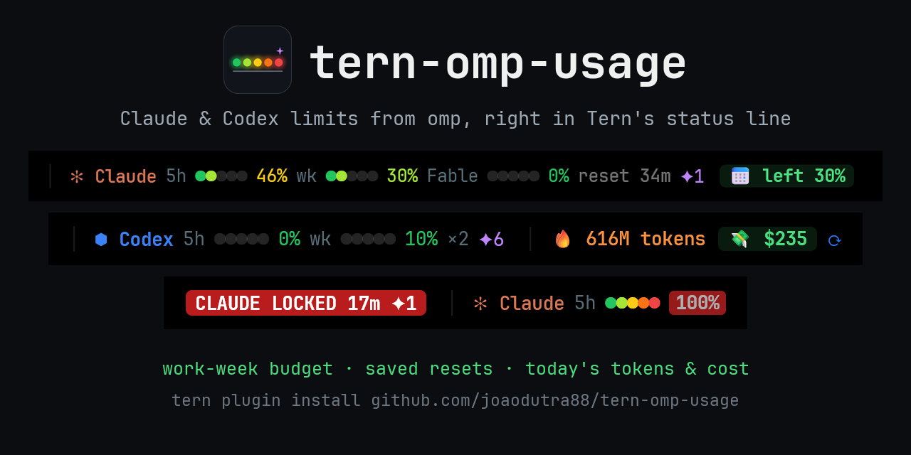
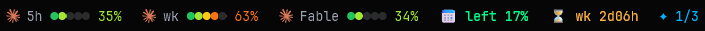

<div align="center">



[](https://github.com/joaodutra88/tern-omp-usage/actions/workflows/check.yml)
[](LICENSE)
[](https://github.com/joaodutra88/tern-omp-usage/stargazers)
[](https://github.com/joaodutra88/tern-omp-usage/releases/latest)

A [Tern](https://stencil.so/tern) plugin for [omp](https://omp.sh) users. Its widgets keep your Claude and Codex subscription limits, this week's budget, your saved resets and today's tokens, cost and speed in Tern's widget bar. Click today's cost for a dashboard of the last 7 days, with every provider omp tracks.

**[Install](#install)** · **[The widgets](#the-widgets)** · **[Configuration](#configuration)** · **[FAQ](#faq)** · **[Contributing](#contributing)**

**English** | [Português](README.pt-BR.md) | [Español](README.es.md) | [简体中文](README.zh-CN.md) | [日本語](README.ja.md)



</div>

## What it answers

Everything stays in the widget bar, so the answers are on screen while you work:

- **Can I afford a heavy run today?** A work-week budget: each weekday unlocks 20% of the weekly quota, and a holiday's share carries over.
- **What did today cost?** Tokens and API-price cost since midnight, across every provider omp tracks, with the running total as an optional graph. The dashboard adds the last 7 days, this month and the cost by model.
- **Do I have a reset saved?** Saved usage-limit resets for Claude and Codex, how many you can use now, and a toast when one becomes usable or is about to expire.
- **When do I run out?** At the current pace, how long until the 5h or weekly window locks, when that comes before its reset. A toast when a window hits 80%, locks or frees up again.
- **Is something wrong?** A widget that only shows up when omp fails or turns a login off.
- **Claude and Codex side by side**, both read through omp, with nothing new to sign in to.

## The widgets

Place them with palette › **Edit widgets…**, in any order. Each one is text; in the same editor the budget can turn into a bar and today's tokens and cost into a graph. Colors follow your Tern theme. Hover a widget for its card: Tern's own hover card, one row per detail, sized to fit in every language. A click refreshes the limits, or opens the dashboard from the budget, tokens, cost and speed. A widget with nothing to say hides itself.

| Widget | Looks like | Meaning |
|---|---|---|
| **Claude 5h**, **Claude wk**, **Claude Fable** | `5h ●●○○○ 40%` | Share of the window used: five dots fill from green to red, and the percentage takes the color of the last dot reached, red from the red-badge threshold (80% unless you change it). `↑` when it rose 3 points or more since the last reading, 5 minutes earlier. At 100% it reads `LOCKED` with the time until it frees up. The card has the share used, the reset and, from 10 minutes into the window, when it runs out at the average pace so far, with the verdict: the reset comes first, or it runs out so long before it. Only 5h carries the provider's icon. Fable shows only when your plan has it. |
| **Codex 5h**, **Codex wk** | `5h ●●○○○ 25%` | Share of your linked Codex accounts used up, in the same dots; the card counts the accounts. Hidden when omp has no Codex account. |
| **Work-week budget** | `📅 left 21%` | Each work day (Monday to Friday unless you change it) of the current 7-day window unlocks an equal share of the weekly quota, 20% with five days. `left` is quota unlocked and not spent yet; `over`, in red, means you are spending ahead of the week. |
| **Runs out** | `⏳ wk 2d16h` | At the average pace since a Claude window opened, it runs out in this long, before its reset. Shows from 50% used. |
| **Saved resets** | `✦ 1/3` | Saved usage-limit resets, usable now / saved (one number when all of them are usable). The card lists what each one clears, whether it is usable now and when it expires. |
| **Tokens today**, **Cost today** | `🔥 56M`, `💸 $30` | Tokens and API-price cost since local midnight, all providers, from `omp stats`; the graph is the running total. The tokens card adds the week since Monday (the days Tern was open, as kept for the dashboard) and today's requests; the cost card, the last 7 days and this month. Cache reads count as tokens, so most of this number is cache. |
| **Speed and cache** | `⚡ 79 tok/s · ♻ 99%` | Average output speed and cache hit rate over omp's last day; the card adds the time to the first token and the share of input cost the cache saved. |
| **Problems** | `⚠ Codex off` | Only when an `omp usage` call failed or omp turned a login off; the card has the cause, without the account's e-mail. |
| **Plugin update** | `⬆ 0.6.0` | A newer release of this plugin; click it to install. |

Alerts come as toasts: a window reaching the red-badge threshold, locking or freeing up again; a saved reset becoming usable, or expiring within 2 days; a login omp turns off.

### Dashboard

**OMP usage: dashboard** (or a click on the budget, tokens, cost or speed) opens a pane beside the one you are in. It shows every limit omp tracks hour by hour over the last 7 days (Claude, Codex, Gemini, xAI, OpenCode Go…), from `omp usage --history`; the API-price cost of today, the last 7 days and this month, with a bar per day; and the cost by model from `omp stats`. Press `r` to read it all again.

`omp stats` only goes back about a day, so the plugin keeps each day's total itself. The week and the month fill in from the day you install 0.4.0.

## Install

```sh
tern plugin install https://github.com/joaodutra88/tern-omp-usage
```

You need `omp` signed in to Anthropic and/or OpenAI Codex, so `omp usage` works in a terminal. The plugin uses the omp that Tern manages (`%LOCALAPPDATA%\Tern\omp\bin\omp.exe` on Windows, `~/Library/Application Support/Tern/omp/bin/omp` on macOS) and falls back to `omp` on `PATH`. If Tern's daemon can't find it, set `OMP_USAGE_BIN` to the full path.

Then place the widgets you want: palette › **Edit widgets…** (Tern 0.9.17 or later).

### Updates

Once a day the plugin checks GitHub for a newer release. When there is one, the **Plugin update** widget shows a blue `⬆ 0.6.0` and a toast tells you once. Click it, or run **OMP usage: update to the latest version**, and the plugin reinstalls itself from this repository (`tern plugin install … --force`). Your settings and your `extras.luau` carry over. After the update a toast names the new version, and **OMP usage: what's new** opens its release notes.

A linked checkout (`tern plugin link`) updates with `git pull` instead. To stop checking, turn off the `updates` part (see [Configuration](#configuration)) or set `OMP_USAGE_NO_UPDATE_CHECK=1`.

**Coming from 0.4.x?** 0.5.0 moves the usage out of the **Plugin segments** widget into widgets of its own, so the bar is empty until you place them: palette › **Edit widgets…**. The toast after the update says so.

**On 0.3.x?** Those versions have no update check. Run the install command above once with `--force`, and from 0.4.0 on the plugin tells you itself.

To hear about releases by e-mail too, use **Watch → Custom → Releases** at the top of this repository.

### Install with your AI agent

Paste this into omp, Claude Code, Codex or any agent that can run commands:

```text
Install the Tern plugin https://github.com/joaodutra88/tern-omp-usage for me.
1. Check `omp usage --json -p anthropic` (or `-p openai-codex`) works. If it doesn't, help me sign in with omp first.
2. Run `tern plugin install https://github.com/joaodutra88/tern-omp-usage`.
3. Run `tern plugin list --json` and confirm `omp-usage` has status "ready".
4. If it isn't ready, read the lines containing `omp-usage` in Tern's log
   (`%LOCALAPPDATA%\Tern\Logs\tern.log` on Windows) and the repo's AGENTS.md, then tell me what is wrong.
5. Help me place the plugin's widgets (palette › Edit widgets…) and explain what each one means, using the README.
```

## What it runs and what it touches

The plugin reads no credentials. It runs omp, and makes one network request of its own:

| Command | When |
|---|---|
| `omp usage --json -p anthropic` | Every 5 min. Anthropic's usage endpoint answers 429 below about 5 min. |
| `omp usage --json -p openai-codex` | Every 5 min |
| `omp stats --json` | Every 5 min |
| `omp usage --history --json --days 7`, then `omp stats --json` | When the dashboard opens, and when you press `r` in it |
| `omp usage invalidate` | When you click a limit widget, to skip omp's cache |
| `GET api.github.com/repos/joaodutra88/tern-omp-usage/releases/latest` | Once a day per machine, no token; off with the `updates` part or `OMP_USAGE_NO_UPDATE_CHECK=1` |
| `tern plugin install https://github.com/joaodutra88/tern-omp-usage --force` | Only when you click `⬆` or run the update command |

Settings, each day's tokens and cost (for the dashboard), the saved resets already warned about, the last release seen and a copy of your `extras.luau` (made before an update) go to the plugin's data folder (`tern.kv`), nowhere else. A widget only reads values cached by those calls, because Tern gives its render 4 ms.

## Configuration

Open the command palette and type `OMP usage`. Settings are kept in the plugin's data folder, so an update or a reinstall keeps them.

| Command | Does |
|---|---|
| **OMP usage: show or hide a part…** | Type a part to turn it on or off: `alerts` (the toasts) or `updates` (the daily release check). What the bar shows is up to the widgets you place. |
| **OMP usage: language…** | `en`, `pt-BR`, `es`, `zh-CN`, `ja`, `de` or `fr`. |
| **OMP usage: work days per week…** | How many days, counted from Monday, unlock the weekly quota. The default `5` means Monday to Friday, 20% each. |
| **OMP usage: red badge threshold…** | The percentage where a window turns red and its alert toast fires (default 80). |
| **OMP usage: reset settings** | Back to the defaults. |
| **OMP usage: check for updates** | Asks GitHub now, even with `updates` off. |
| **OMP usage: dashboard** | Opens the dashboard, or focuses it when this window already has one. |
| **OMP usage: what's new** | Opens the release notes of the version you run. |

If Tern's daemon can't find `omp`, set the `OMP_USAGE_BIN` environment variable to its full path.

### In your language

Every word the plugin shows lives in `labels.luau`, one table per language. To add one, copy `en`, translate the values and open a pull request. Keys a language leaves out fall back to English.

### Your own widgets

If an `extras.luau` file sits next to `window.luau`, the plugin loads it. Git ignores it, so personal widgets never reach the repository. An update copies it to the plugin's data folder first, and the plugin loads that copy when the one beside `window.luau` is gone:

```luau
local M = {}
function M.init(hidden, every) end -- register widgets (tern.chrome.widget), commands, timers, CSS
function M.segments(out, pane) end -- optional: segments for Tern's Plugin segments widget
return M
```

## FAQ

**`tern plugin list` shows the plugin as `disabled`.**
Tern disables a plugin that errors or whose widget render runs over its time budget. Run `tern plugin reload`, then look for lines with `omp-usage` in Tern's log (`%LOCALAPPDATA%\Tern\Logs\tern.log` on Windows) and open an issue with them.

**A limit widget shows `5h ?`.**
The last `omp usage` call failed, and the **Problems** widget says which. Check that `omp usage --json -p anthropic` (or `-p openai-codex`) works in a terminal, and sign in with omp if it doesn't. Click the widget to retry.

**Nothing shows up at all.**
Place the widgets: palette › **Edit widgets…**. If they are placed and stay empty, Tern's daemon may not find `omp`: set `OMP_USAGE_BIN` to its full path and restart Tern.

**The numbers lag behind claude.ai.**
They come from the same usage endpoint through omp, every 5 minutes, because Anthropic rate-limits faster polling. Click a limit widget to force a fresh read.

**Why is today's token count so high?**
It includes cache reads, which make up most of an agent's input. The cost is what those tokens would cost at API prices, not what your subscription charges.

**How do I update?**
Click the blue `⬆` of the **Plugin update** widget when it shows, or run **OMP usage: update to the latest version**. By hand: `tern plugin install https://github.com/joaodutra88/tern-omp-usage --force`. Versions before 0.4.0 have no update check, and on Windows the 0.4.0 update fails with "The process cannot access the file", so update those once by hand.

**How do I uninstall it?**
`tern plugin remove omp-usage`.

## Contributing

This is open source under MIT: use it, fork it, change it, ship it. Issues and pull requests are open to everyone.

- `python scripts/check.py` runs the syntax check, the unit tests, the CSS and manifest checks; `--integration` runs the whole plugin in a fake Tern with recorded `omp` and GitHub answers. CI runs both on every pull request, on Linux, Windows and macOS. Add `--tern` to also reload the plugin in your Tern and read its log.
- Using an AI agent? Point it at [AGENTS.md](AGENTS.md). It explains the rules that are easy to break and how to file a clean bug report for you.
- What's planned, and what a change has to respect: [ROADMAP.md](ROADMAP.md). Ideas go to [Discussions](https://github.com/joaodutra88/tern-omp-usage/discussions); issues marked **good first issue** are a good start.
- More in [CONTRIBUTING.md](CONTRIBUTING.md). Everyone taking part follows the [Code of Conduct](CODE_OF_CONDUCT.md); security problems go through [SECURITY.md](SECURITY.md).

## Star history

[](https://star-history.com/#joaodutra88/tern-omp-usage&Date)
