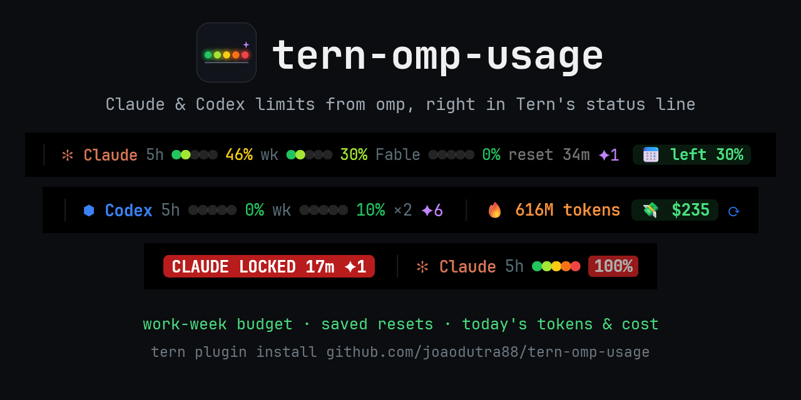
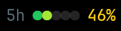
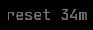
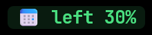

<div align="center">



[](https://github.com/joaodutra88/tern-omp-usage/actions/workflows/check.yml)
[](LICENSE)
[](https://github.com/joaodutra88/tern-omp-usage/stargazers)
[](https://github.com/joaodutra88/tern-omp-usage/releases/latest)

A [Tern](https://stencil.so/tern) status-line plugin for [omp](https://omp.sh) users. It keeps your Claude and Codex subscription limits, this week's spending budget and today's tokens and cost on screen, in one line. Click today's cost for a dashboard of the last 7 days.

**[Install](#install)** · **[What each part means](#what-each-part-means)** · **[Configuration](#configuration)** · **[FAQ](#faq)** · **[Contributing](#contributing)**

**English** | [Português](README.pt-BR.md) | [Español](README.es.md) | [简体中文](README.zh-CN.md) | [日本語](README.ja.md)


</div>

## What it answers

Everything stays in the status line, so the answers are on screen while you work:

- **Can I afford a heavy run today?** A work-week budget: each weekday unlocks 20% of the weekly quota, and a holiday's share carries over.
- **What did today cost?** Tokens and API-price cost since midnight, across every provider omp tracks. The dashboard adds the last 7 days and this month.
- **Do I have a reset saved?** Saved usage-limit resets for Claude and Codex.
- **When do I run out?** At the current pace, how long until the 5h or weekly window locks, when that comes before its reset. A toast when a window hits 80%, locks or frees up again.
- **Claude and Codex side by side**, both read through omp, with nothing new to sign in to.

## What each part means

| Looks like | Meaning |
|---|---|
|  | Usage of one window: 5h, week (`wk`), and Fable when your plan has it. Each dot keeps its own color, green to red, and the percentage takes the color of the last dot reached. At 80% (you can change this) the percentage turns into a pulsing red badge. |
|  | Time until the Claude 5h window resets. Turns green when it is under 30 min and the 5h window is at 80% or more, meaning relief is close. |
| `⏳23m` | Right after the Claude 5h or `wk` bar: at the average pace since that window opened, it runs out in this long, before its reset. Shows from 50% used. Alerts come as toasts: a window reaching the red-badge threshold, locking, or freeing up again. |
|  | Usage-limit resets you have saved. |
|  | Work-week budget. Each work day (Monday to Friday unless you change it) of the current 7-day window unlocks an equal share of the weekly quota, 20% with five days. `left` is quota unlocked and not spent yet. `over` (pulsing red) means you are spending ahead of the week. |
|  | Codex. `×2` is the number of linked accounts, and the windows show the share of accounts used up. |
|  | Tokens and API-price cost since local midnight, all providers, from `omp stats`. Cache reads count as tokens, so most of this number is cache. Click it to open the dashboard. |
|  | Refresh now. Clicking any other usage segment does the same. |

### Dashboard

**OMP usage: dashboard** (or a click on today's tokens or cost) opens a pane beside the one you are in. It shows Claude and Codex 5h and weekly usage hour by hour over the last 7 days, from `omp usage --history`, and the API-price cost of today, the last 7 days and this month, with a bar per day. Press `r` to read the history again.

`omp stats` only goes back about a day, so the plugin keeps each day's total itself. The week and the month fill in from the day you install 0.4.0.

## How it looks as the week goes

These were rendered from canned `omp` replies, so you can see states that don't happen every day.

**Quiet morning.** Everything green, plenty of budget.

<p align="center"></p>

**Usage climbing.** A `↑` appears when a window rose 3 points or more since the last reading, 5 minutes earlier.

<p align="center"></p>

**Hot 5h window.** At 86% the percentage becomes a red badge, and the reset turns green because relief is 21 minutes away.

<p align="center"></p>

**Ahead of the week.** 65% of the week used with only 40% unlocked: `over 25%` pulses until the next weekday catches up.

<p align="center"></p>

**Locked.** A window at 100% shows a pulsing badge with the time until it frees up and your saved resets.

<p align="center"></p>

## Install

```sh
tern plugin install https://github.com/joaodutra88/tern-omp-usage
```

You need `omp` signed in to Anthropic and/or OpenAI Codex, so `omp usage` works in a terminal. The plugin uses the omp that Tern manages (`%LOCALAPPDATA%\Tern\omp\bin\omp.exe` on Windows, `~/Library/Application Support/Tern/omp/bin/omp` on macOS) and falls back to `omp` on `PATH`. If Tern's daemon can't find it, set `OMP_USAGE_BIN` to the full path.

### Updates

Once a day the plugin checks GitHub for a newer release. When there is one, a blue `⬆ 0.5.0` appears at the start of its segments and a toast tells you once. Click it, or run **OMP usage: update to the latest version**, and the plugin reinstalls itself from this repository (`tern plugin install … --force`). Your settings and your `extras.luau` carry over. After the update a toast names the new version, and **OMP usage: what's new** opens its release notes.

A linked checkout (`tern plugin link`) updates with `git pull` instead. To stop checking, hide the `updates` part (see [Configuration](#configuration)) or set `OMP_USAGE_NO_UPDATE_CHECK=1`.

### Install with your AI agent

Paste this into omp, Claude Code, Codex or any agent that can run commands:

```text
Install the Tern plugin https://github.com/joaodutra88/tern-omp-usage for me.
1. Check `omp usage --json -p anthropic` (or `-p openai-codex`) works. If it doesn't, help me sign in with omp first.
2. Run `tern plugin install https://github.com/joaodutra88/tern-omp-usage`.
3. Run `tern plugin list --json` and confirm `omp-usage` has status "ready".
4. If it isn't ready, read the lines containing `omp-usage` in Tern's log
   (`%LOCALAPPDATA%\Tern\Logs\tern.log` on Windows) and the repo's AGENTS.md, then tell me what is wrong.
5. Explain what each part of the status line means, using the README.
```

## What it runs and what it touches

The plugin reads no credentials. It runs omp, and makes one network request of its own:

| Command | When |
|---|---|
| `omp usage --json -p anthropic` | Every 5 min. Anthropic's usage endpoint answers 429 below about 5 min. |
| `omp usage --json -p openai-codex` | Every 5 min |
| `omp stats --json` | Every 5 min |
| `omp usage --history --json --days 7` | When the dashboard opens, and when you press `r` in it |
| `omp usage invalidate` | When you click a segment, to skip omp's cache |
| `GET api.github.com/repos/joaodutra88/tern-omp-usage/releases/latest` | Once a day per machine, no token; off with the `updates` part or `OMP_USAGE_NO_UPDATE_CHECK=1` |
| `tern plugin install https://github.com/joaodutra88/tern-omp-usage --force` | Only when you click `⬆` or run the update command |

Settings, each day's tokens and cost (for the dashboard), the last release seen and a copy of your `extras.luau` (made before an update) go to the plugin's data folder (`tern.kv`), nowhere else. The status formatter only reads values cached by those calls, because Tern gives a formatter 4 ms.

## Configuration

Open the command palette and type `OMP usage`. Settings are kept in the plugin's data folder, so an update or a reinstall keeps them.

| Command | Does |
|---|---|
| **OMP usage: show or hide a part…** | Type a part to turn it on or off: `claude`, `codex`, `today`, `cost`, `budget`, `reset`, `credits`, `fable`, `forecast` (the `⏳`), `alerts` (the toasts), `updates`. |
| **OMP usage: language…** | `en`, `pt-BR`, `es`, `zh-CN` or `ja`. |
| **OMP usage: work days per week…** | How many days, counted from Monday, unlock the weekly quota. The default `5` means Monday to Friday, 20% each. |
| **OMP usage: red badge threshold…** | The percentage where a window becomes the pulsing red badge (default 80). |
| **OMP usage: reset settings** | Back to the defaults. |
| **OMP usage: check for updates** | Asks GitHub now, even with `updates` hidden. |
| **OMP usage: dashboard** | Opens the dashboard, or focuses it when this window already has one. |
| **OMP usage: what's new** | Opens the release notes of the version you run. |

If Tern's daemon can't find `omp`, set the `OMP_USAGE_BIN` environment variable to its full path. Colors are plain CSS at the bottom of `window.luau`. Each segment is `#statusline .sl-plugin[title="plugin.omp-usage.<name>"]`.

### In your language

Every word the plugin shows lives in `labels.luau`, one table per language. To add one, copy `en`, translate the values and open a pull request. Keys a language leaves out fall back to English.

### Your own segments

If an `extras.luau` file sits next to `window.luau`, the plugin loads it. Git ignores it, so personal segments never reach the repository. An update copies it to the plugin's data folder first, and the plugin loads that copy when the one beside `window.luau` is gone:

```luau
local M = {}
function M.init(hidden, every) end -- register commands, timers, CSS
function M.segments(out, pane) end -- insert segments before the usage ones
return M
```

## FAQ

**`tern plugin list` shows the plugin as `disabled`.**
Tern disables a plugin that errors or whose status formatter runs over its time budget. Run `tern plugin reload`, then look for lines with `omp-usage` in Tern's log (`%LOCALAPPDATA%\Tern\Logs\tern.log` on Windows) and open an issue with them.

**The bar shows `✻ Claude ?` or `⬢ Codex ?`.**
The last `omp usage` call failed. Check that `omp usage --json -p anthropic` (or `-p openai-codex`) works in a terminal, and sign in with omp if it doesn't. Click any segment to retry.

**Nothing shows up at all.**
Make sure the status line is on (`"status_bar": true` in Tern's settings). If it is, Tern's daemon may not find `omp`: set `OMP_USAGE_BIN` to its full path and restart Tern.

**The numbers lag behind claude.ai.**
They come from the same usage endpoint through omp, every 5 minutes, because Anthropic rate-limits faster polling. Click a segment to force a fresh read.

**Why is today's token count so high?**
It includes cache reads, which make up most of an agent's input. The cost is what those tokens would cost at API prices, not what your subscription charges.

**How do I update?**
Click the blue `⬆` when it shows, or run **OMP usage: update to the latest version**. By hand: `tern plugin install https://github.com/joaodutra88/tern-omp-usage --force`. Versions before 0.4.0 have no update check, so update those once by hand.

**How do I uninstall it?**
`tern plugin remove omp-usage`.

## Contributing

This is open source under MIT: use it, fork it, change it, ship it. Issues and pull requests are open to everyone.

- `python scripts/check.py` validates syntax, tests, CSS and the manifest. CI runs the same thing. Add `--tern` to also reload the plugin in your Tern and read its log.
- Using an AI agent? Point it at [AGENTS.md](AGENTS.md). It explains the rules that are easy to break and how to file a clean bug report for you.
- More in [CONTRIBUTING.md](CONTRIBUTING.md). Everyone taking part follows the [Code of Conduct](CODE_OF_CONDUCT.md); security problems go through [SECURITY.md](SECURITY.md).

## Star history

[](https://star-history.com/#joaodutra88/tern-omp-usage&Date)
