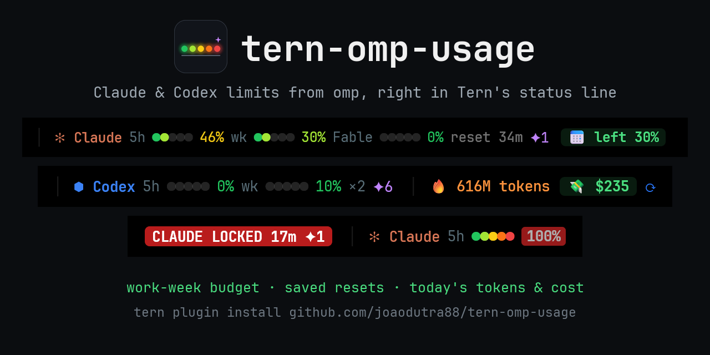
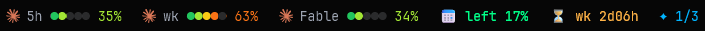

<div align="center">



[](https://github.com/joaodutra88/tern-omp-usage/actions/workflows/check.yml)
[](LICENSE)
[](https://github.com/joaodutra88/tern-omp-usage/stargazers)
[](https://github.com/joaodutra88/tern-omp-usage/releases/latest)

Um plugin do [Tern](https://stencil.so/tern) para usuários do [omp](https://omp.sh). Os widgets dele mantêm na barra de widgets do Tern os limites de assinatura do Claude e do Codex, o orçamento da semana, os seus resets salvos e os tokens, o custo e a velocidade de hoje. Clique no custo de hoje para abrir um painel com os últimos 7 dias, com todos os provedores que o omp acompanha.

**[Instalação](#instalação)** · **[Os widgets](#os-widgets)** · **[Configuração](#configuração)** · **[FAQ](#faq)** · **[Contribuindo](#contribuindo)**

[English](README.md) | **Português** | [Español](README.es.md) | [简体中文](README.zh-CN.md) | [日本語](README.ja.md)

O README em inglês é a referência e prevalece se houver diferença.



</div>

## O que ele responde

Tudo fica na barra de widgets, então as respostas estão na tela enquanto você trabalha:

- **Dá pra encarar uma execução pesada hoje?** Um orçamento da semana de trabalho: cada dia útil libera 20% da cota semanal, e a parte de um feriado fica guardada.
- **Quanto custou hoje?** Tokens e custo ao preço da API desde a meia-noite, em todos os provedores que o omp acompanha, com o total acumulado num gráfico opcional. O painel mostra também os últimos 7 dias, o mês e o custo por modelo.
- **Tenho um reset guardado?** Resets salvos de limite de uso para Claude e Codex, quantos dá para usar agora, e um aviso quando um fica usável ou está para expirar.
- **Quando o limite acaba?** No ritmo atual, quanto tempo falta para a janela de 5h ou a semanal travar, quando isso acontece antes do reset. Um aviso aparece quando uma janela chega a 80%, trava ou volta a liberar.
- **Tem algo errado?** Um widget que só aparece quando o omp falha ou desliga um login.
- **Claude e Codex lado a lado**, ambos lidos pelo omp, sem nenhum login novo.

## Os widgets

Posicione-os pela paleta › **Edit widgets…**, na ordem que quiser. Todos são texto; no mesmo editor o orçamento pode virar barra e os tokens e o custo de hoje, gráfico. As cores seguem o tema do seu Tern. Passe o mouse sobre um widget para ver o card dele: o próprio card de hover do Tern, uma linha por detalhe, dimensionado para caber em todos os idiomas. Um clique atualiza os limites, ou abre o painel a partir do orçamento, dos tokens, do custo e da velocidade. Um widget sem nada para mostrar se esconde.

| Widget | Aparência | Significado |
|---|---|---|
| **Claude 5h**, **Claude wk**, **Claude Fable** | `5h ●●○○○ 40%` | Parte da janela já usada, ao lado do ícone do provedor: cinco bolinhas enchem do verde ao vermelho, e a porcentagem fica na cor da última bolinha alcançada, vermelha a partir do limite do selo vermelho (80%, a menos que você mude). `↑` quando subiu 3 pontos ou mais desde a última leitura, 5 minutos antes. Em 100% mostra `LOCKED` com o tempo até liberar. O card traz a parte usada, o reset e, a partir de 10 minutos de janela, quando ela acaba no ritmo médio até agora, com o veredito: o reset vem antes, ou ela acaba tanto tempo antes dele. Fable só aparece quando o seu plano tem. |
| **Codex 5h**, **Codex wk** | `5h ●●○○○ 25%` | Parte das suas contas do Codex vinculadas que já foi esgotada, nas mesmas bolinhas; o card conta as contas. Fica oculto quando o omp não tem conta do Codex. |
| **Work-week budget** | `📅 left 21%` | Cada dia útil (de segunda a sexta, a menos que você mude) da janela atual de 7 dias libera uma parte igual da cota semanal, 20% com cinco dias. `left` é a cota liberada e ainda não gasta; `over`, em vermelho, significa que você está gastando à frente da semana. |
| **Runs out** | `⏳ wk 2d16h` | Na média de uso desde que uma janela do Claude abriu, ela acaba nesse tempo, antes do reset. Aparece a partir de 50% de uso. |
| **Saved resets** | `✦ 1/3` | Resets de limite de uso salvos, usáveis agora / salvos (um número só quando todos são usáveis). O card lista o que cada um libera, se já dá para usar agora e quando expira. |
| **Tokens today**, **Cost today** | `🔥 56M`, `💸 $30` | Tokens e custo ao preço da API desde a meia-noite local, todos os provedores, a partir de `omp stats`; o gráfico é o total acumulado. O card dos tokens acrescenta a semana desde segunda (os dias em que o Tern ficou aberto, como guardados para o painel) e as requisições de hoje; o do custo, os últimos 7 dias e este mês. Leituras de cache contam como tokens, então a maior parte desse número é cache. |
| **Speed and cache** | `⚡ 79 tok/s · ♻ 99%` | Velocidade média de saída e taxa de acerto do cache no último dia do omp; o card acrescenta o tempo até o primeiro token e a parte do custo de entrada que o cache economizou. |
| **Problems** | `⚠ Codex off` | Só quando uma chamada de `omp usage` falhou ou o omp desligou um login; o card traz a causa, sem o e-mail da conta. |
| **Plugin update** | `⬆ 0.6.0` | Uma versão nova deste plugin; clique para instalar. |

Os alertas chegam como avisos: uma janela que atinge o limite do selo vermelho, trava ou volta a liberar; um reset salvo que fica usável ou expira em até 2 dias; um login que o omp desliga.

### Painel

**OMP usage: dashboard** (ou um clique no orçamento, nos tokens, no custo ou na velocidade) abre um painel ao lado do que você está usando. Ele mostra, hora a hora, nos últimos 7 dias, cada limite que o omp acompanha (Claude, Codex, Gemini, xAI, OpenCode Go…), a partir de `omp usage --history`; o custo ao preço da API de hoje, dos últimos 7 dias e do mês, com uma barra por dia; e o custo por modelo, a partir de `omp stats`. Aperte `r` para ler tudo de novo.

O `omp stats` só guarda cerca de um dia, então o plugin registra o total de cada dia por conta própria. A semana e o mês vão se completando a partir do dia em que você instala a 0.4.0.

## Instalação

```sh
tern plugin install https://github.com/joaodutra88/tern-omp-usage
```

Você precisa do `omp` logado na Anthropic e/ou no OpenAI Codex, de forma que `omp usage` funcione em um terminal. O plugin usa o omp que o Tern gerencia (`%LOCALAPPDATA%\Tern\omp\bin\omp.exe` no Windows, `~/Library/Application Support/Tern/omp/bin/omp` no macOS) e recorre ao `omp` no `PATH`. Se o daemon do Tern não encontrar o executável, defina `OMP_USAGE_BIN` com o caminho completo.

Depois, posicione os widgets que quiser: paleta › **Edit widgets…** (Tern 0.9.17 ou mais novo).

### Atualizações

Uma vez por dia o plugin consulta o GitHub atrás de uma versão nova. Quando existe, o widget **Plugin update** mostra um `⬆ 0.6.0` azul e um aviso mostra isso uma vez. Clique nele, ou rode **OMP usage: update to the latest version**, e o plugin se reinstala a partir deste repositório (`tern plugin install … --force`). Suas configurações e o seu `extras.luau` continuam. Depois da atualização, um aviso mostra a nova versão, e **OMP usage: what's new** abre as notas da versão.

Um checkout vinculado (`tern plugin link`) se atualiza com `git pull`. Para parar a consulta, desligue a parte `updates` (veja [Configuração](#configuração)) ou defina `OMP_USAGE_NO_UPDATE_CHECK=1`.

**Vindo da 0.4.x?** A 0.5.0 tira o uso do widget **Plugin segments** e o passa para widgets próprios, então a barra fica vazia até você posicioná-los: paleta › **Edit widgets…**. O aviso depois da atualização diz isso.

**Está na 0.3.x?** Essas versões não verificam atualizações. Rode o comando de instalação acima uma vez com `--force`, e da 0.4.0 em diante o próprio plugin avisa você.

Para saber das versões novas também por e-mail, use **Watch → Custom → Releases** no topo deste repositório.

### Instalar com o seu agente de IA

Cole isto no omp, no Claude Code, no Codex ou em qualquer agente que consiga executar comandos:

```text
Install the Tern plugin https://github.com/joaodutra88/tern-omp-usage for me.
1. Check `omp usage --json -p anthropic` (or `-p openai-codex`) works. If it doesn't, help me sign in with omp first.
2. Run `tern plugin install https://github.com/joaodutra88/tern-omp-usage`.
3. Run `tern plugin list --json` and confirm `omp-usage` has status "ready".
4. If it isn't ready, read the lines containing `omp-usage` in Tern's log
   (`%LOCALAPPDATA%\Tern\Logs\tern.log` on Windows) and the repo's AGENTS.md, then tell me what is wrong.
5. Help me place the plugin's widgets (palette › Edit widgets…) and explain what each one means, using the README.
```

## O que ele executa e o que toca

O plugin não lê credenciais. Ele executa o omp e faz uma única requisição de rede própria:

| Comando | Quando |
|---|---|
| `omp usage --json -p anthropic` | A cada 5 min. O endpoint de uso da Anthropic responde 429 abaixo de cerca de 5 min. |
| `omp usage --json -p openai-codex` | A cada 5 min |
| `omp stats --json` | A cada 5 min |
| `omp usage --history --json --days 7`, depois `omp stats --json` | Quando o painel abre e quando você aperta `r` nele |
| `omp usage invalidate` | Quando você clica em um widget de limite, para pular o cache do omp |
| `GET api.github.com/repos/joaodutra88/tern-omp-usage/releases/latest` | Uma vez por dia por máquina, sem token; desligue com a parte `updates` ou com `OMP_USAGE_NO_UPDATE_CHECK=1` |
| `tern plugin install https://github.com/joaodutra88/tern-omp-usage --force` | Só quando você clica em `⬆` ou roda o comando de atualização |

As configurações, os tokens e o custo de cada dia (para o painel), os resets salvos que já foram avisados, a última versão vista e uma cópia do seu `extras.luau` (feita antes de uma atualização) vão para a pasta de dados do plugin (`tern.kv`), e para nenhum outro lugar. Um widget só lê os valores em cache dessas chamadas, porque o Tern dá 4 ms para a renderização dele.

## Configuração

Abra a paleta de comandos e digite `OMP usage`. As configurações ficam na pasta de dados do plugin, então uma atualização ou reinstalação as mantém.

| Comando | O que faz |
|---|---|
| **OMP usage: show or hide a part…** | Digite uma parte para ligar ou desligar: `alerts` (os avisos) ou `updates` (a consulta diária de versão). O que a barra mostra depende dos widgets que você posiciona. |
| **OMP usage: language…** | `en`, `pt-BR`, `es`, `zh-CN`, `ja`, `de` ou `fr`. |
| **OMP usage: work days per week…** | Quantos dias, contando a partir de segunda, liberam a cota semanal. O padrão `5` significa de segunda a sexta, 20% cada. |
| **OMP usage: red badge threshold…** | A porcentagem em que uma janela fica vermelha e o aviso de alerta dela dispara (padrão 80). |
| **OMP usage: reset settings** | Volta aos padrões. |
| **OMP usage: check for updates** | Consulta o GitHub na hora, mesmo com `updates` desligado. |
| **OMP usage: dashboard** | Abre o painel, ou foca nele quando esta janela já tem um. |
| **OMP usage: what's new** | Abre as notas da versão que você está rodando. |

Se o daemon do Tern não encontrar o `omp`, defina a variável de ambiente `OMP_USAGE_BIN` com o caminho completo.

### No seu idioma

Cada palavra que o plugin mostra fica em `labels.luau`, uma tabela por idioma. Para adicionar um, copie `en`, traduza os valores e abra um pull request. As chaves que um idioma deixar de fora caem no inglês.

### Seus próprios widgets

Se existir um arquivo `extras.luau` ao lado de `window.luau`, o plugin o carrega. O Git o ignora, então widgets pessoais nunca chegam ao repositório. Uma atualização copia o arquivo antes para a pasta de dados do plugin, e o plugin carrega essa cópia quando o arquivo ao lado de `window.luau` não existe mais:

```luau
local M = {}
function M.init(hidden, every) end -- register widgets (tern.chrome.widget), commands, timers, CSS
function M.segments(out, pane) end -- optional: segments for Tern's Plugin segments widget
return M
```

## FAQ

**`tern plugin list` mostra o plugin como `disabled`.**
O Tern desativa um plugin que dá erro ou cuja renderização de widget estoura o tempo previsto. Rode `tern plugin reload`, depois procure as linhas com `omp-usage` no log do Tern (`%LOCALAPPDATA%\Tern\Logs\tern.log` no Windows) e abra uma issue com elas.

**Um widget de limite mostra `5h ?`.**
A última chamada de `omp usage` falhou, e o widget **Problems** diz qual. Confira se `omp usage --json -p anthropic` (ou `-p openai-codex`) funciona em um terminal e, se não funcionar, faça login no omp. Clique no widget para tentar de novo.

**Não aparece nada.**
Posicione os widgets: paleta › **Edit widgets…**. Se estiverem posicionados e continuarem vazios, o daemon do Tern pode não encontrar o `omp`: defina `OMP_USAGE_BIN` com o caminho completo e reinicie o Tern.

**Os números ficam atrás do claude.ai.**
Eles vêm do mesmo endpoint de uso, pelo omp, a cada 5 minutos, porque a Anthropic limita a frequência de consultas. Clique em um widget de limite para forçar uma leitura nova.

**Por que a contagem de tokens de hoje é tão alta?**
Ela inclui as leituras de cache, que formam a maior parte da entrada de um agente. O custo é o que esses tokens custariam ao preço da API, não o que a sua assinatura cobra.

**Como atualizo?**
Clique no `⬆` azul do widget **Plugin update** quando ele aparecer, ou rode **OMP usage: update to the latest version**. Na mão: `tern plugin install https://github.com/joaodutra88/tern-omp-usage --force`. Versões anteriores à 0.4.0 não verificam atualizações, e no Windows a atualização da 0.4.0 falha com "The process cannot access the file", então atualize essas uma vez na mão.

**Como desinstalo?**
`tern plugin remove omp-usage`.

## Contribuindo

Este projeto é open source sob MIT: use, faça fork, altere, publique. Issues e pull requests são abertos a todos.

- `python scripts/check.py` roda a checagem de sintaxe, os testes unitários e as checagens de CSS e do manifesto; `--integration` roda o plugin inteiro num Tern falso, com respostas gravadas do `omp` e do GitHub. O CI roda as duas em todo pull request, no Linux, no Windows e no macOS. Adicione `--tern` para também recarregar o plugin no seu Tern e ler o log dele.
- Usando um agente de IA? Aponte para [AGENTS.md](AGENTS.md). Ele explica as regras que são fáceis de quebrar e como abrir um relatório de bug limpo para você.
- O que está planejado, e o que uma mudança precisa respeitar: [ROADMAP.md](ROADMAP.md) (em inglês). Ideias vão para as [Discussions](https://github.com/joaodutra88/tern-omp-usage/discussions); as issues marcadas como **good first issue** são um bom começo.
- Mais em [CONTRIBUTING.md](CONTRIBUTING.md). Todos que participam seguem o [Código de Conduta](CODE_OF_CONDUCT.md); problemas de segurança passam pelo [SECURITY.md](SECURITY.md).

## Histórico de estrelas

[](https://star-history.com/#joaodutra88/tern-omp-usage&Date)
