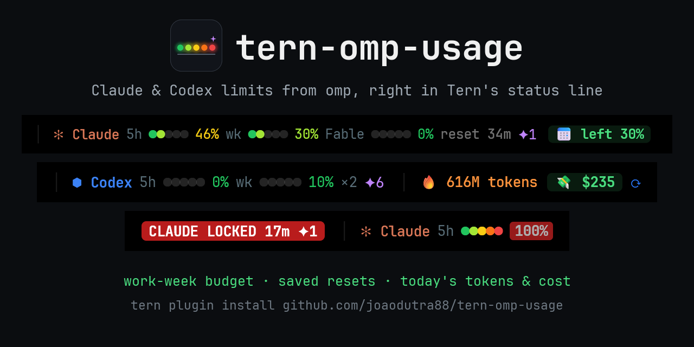
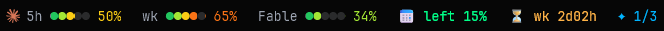

<div align="center">



[](https://github.com/joaodutra88/tern-omp-usage/actions/workflows/check.yml)
[](LICENSE)
[](https://github.com/joaodutra88/tern-omp-usage/stargazers)
[](https://github.com/joaodutra88/tern-omp-usage/releases/latest)

一个面向 [omp](https://omp.sh) 用户的 [Tern](https://stencil.so/tern) 插件。它的小组件在 Tern 的小组件栏中显示你的 Claude 和 Codex 订阅额度、本周的预算、已保存的重置，以及今天的 token 用量、费用和速度。点击今天的费用即可打开最近 7 天的仪表盘，涵盖 omp 追踪的所有提供商。

**[安装](#安装)** · **[小组件](#小组件)** · **[配置](#配置)** · **[FAQ](#faq)** · **[贡献](#贡献)**

[English](README.md) | [Português](README.pt-BR.md) | [Español](README.es.md) | **简体中文** | [日本語](README.ja.md)

英文版 README.md 是参考版本，如两者有出入，以英文版为准。



</div>

## 它能告诉你什么

所有信息都在小组件栏里，工作时一眼就能看到：

- **今天能不能承受一次高负载运行？** 工作周预算：周一到周五每个工作日解锁每周额度的 20%，节假日的份额顺延到之后。
- **今天花了多少？** 自当地午夜起的 token 数和按 API 价格计算的费用，覆盖 omp 追踪的所有提供商，累计总量可以用图表显示。仪表盘还会显示最近 7 天、本月的数据以及按模型的费用。
- **有没有已保存的额度重置？** Claude 和 Codex 已保存的用量限制重置、现在可用的数量，以及某个重置变为可用或即将过期时的弹出通知。
- **什么时候会用完？** 按当前速度，5 小时或每周窗口还要多久会锁定（如果锁定会早于其重置）。窗口达到 80%、被锁定或重新释放时会弹出通知。
- **是不是出了问题？** 有一个小组件只在 omp 出错或关闭某个登录时出现。
- **Claude 和 Codex 并排显示**，两者都通过 omp 读取，无需再登录任何新账户。

## 小组件

通过命令面板 › **Edit widgets…** 按任意顺序放置它们。它们都以文本显示；在同一个编辑器里，预算可以改为条形，今天的 token 和费用可以改为图表。颜色跟随你的 Tern 主题。将鼠标悬停在小组件上可查看它的卡片：Tern 自带的悬停卡片，每项详情一行，尺寸适配所有语言。点击会刷新额度，在预算、token、费用和速度小组件上点击则会打开仪表盘。没有内容可显示的小组件会自动隐藏。

| 小组件 | 外观 | 含义 |
|---|---|---|
| **Claude 5h**、**Claude wk**、**Claude Fable** | `5h ●●○○○ 40%` | 窗口的已用比例：五个圆点从绿到红依次填满，百分比使用最后达到的圆点的颜色，达到红色徽章阈值（默认 80%，可以修改）起为红色。相比 5 分钟前的上次读数上升了 3 个百分点或以上时显示 `↑`。达到 100% 时显示 `LOCKED` 以及距离释放的时间。卡片中有已用比例和重置时间；窗口开始 10 分钟后，还会显示按目前的平均速度何时用完，并给出结论：先到重置，或者在重置前多久用完。只有 5h 显示提供商图标。Fable 仅在你的套餐包含时显示。 |
| **Codex 5h**、**Codex wk** | `5h ●●○○○ 25%` | 已关联的 Codex 账户中已用完的比例，用同样的圆点显示；卡片会显示账户数量。omp 中没有 Codex 账户时隐藏。 |
| **Work-week budget** | `📅 left 21%` | 当前 7 天窗口中，每个工作日（默认周一至周五，可以修改）解锁相同份额的每周额度，五个工作日时每天 20%。`left` 表示已解锁但尚未花费的额度；红色的 `over` 表示你的消费超前于本周进度。 |
| **Runs out** | `⏳ wk 2d16h` | 按 Claude 窗口开启以来的平均速度，它将在这段时间后用完，早于其重置。用量达到 50% 起显示。 |
| **Saved resets** | `✦ 1/3` | 已保存的用量限制重置，现在可用 / 已保存（全部可用时只显示一个数字）。卡片会列出每个重置清除哪些窗口、现在是否可用以及何时过期。 |
| **Tokens today**、**Cost today** | `🔥 56M`、`💸 $30` | 自当地午夜起的 token 数和 API 价格费用，覆盖所有提供商，数据来自 `omp stats`；图表为累计总量。token 卡片还会显示自周一起的本周用量（Tern 打开的那几天，即为仪表盘保存的数据）和今天的请求数；费用卡片则显示最近 7 天和本月。缓存读取也计入 token，因此这个数字的大部分来自缓存。 |
| **Speed and cache** | `⚡ 79 tok/s · ♻ 99%` | omp 最近一天的平均输出速度和缓存命中率；卡片还会显示首个 token 的等待时间，以及缓存节省的输入费用比例。 |
| **Problems** | `⚠ Codex off` | 仅在某次 `omp usage` 调用失败或 omp 关闭了某个登录时显示；卡片会给出原因，但不包含账户的电子邮件。 |
| **Plugin update** | `⬆ 0.6.0` | 本插件有更新的版本；点击即可安装。 |

提醒以弹出通知的形式出现：窗口达到红色徽章阈值、被锁定或重新释放时；已保存的重置变为可用或将在 2 天内过期时；omp 关闭某个登录时。

### 仪表盘

**OMP usage: dashboard**（或点击预算、token 数、费用或速度）会在当前窗格旁边打开一个窗格。它根据 `omp usage --history` 按小时显示最近 7 天 omp 追踪的每一项额度（Claude、Codex、Gemini、xAI、OpenCode Go…）；显示今天、最近 7 天和本月按 API 价格计算的费用，每天一根柱条；并根据 `omp stats` 显示按模型的费用。按 `r` 可重新读取全部数据。

`omp stats` 只能回溯约一天，因此插件会自行保存每天的总量。一周和一个月的数据从你安装 0.4.0 的那天开始累积。

## 安装

```sh
tern plugin install https://github.com/joaodutra88/tern-omp-usage
```

你需要在 `omp` 中登录 Anthropic 和/或 OpenAI Codex，以便 `omp usage` 能在终端中正常运行。插件使用 Tern 管理的 omp（Windows 上为 `%LOCALAPPDATA%\Tern\omp\bin\omp.exe`，macOS 上为 `~/Library/Application Support/Tern/omp/bin/omp`），如果找不到，则回退到 `PATH` 中的 `omp`。如果 Tern 的守护进程找不到它，请将 `OMP_USAGE_BIN` 设置为完整路径。

然后放置你想要的小组件：命令面板 › **Edit widgets…**（需要 Tern 0.9.17 或更高版本）。

### 更新

插件每天在 GitHub 上检查一次是否有新版本。如果有，**Plugin update** 小组件会显示蓝色的 `⬆ 0.6.0`，并弹出一次通知。点击它，或运行 **OMP usage: update to the latest version**，插件就会从本仓库重新安装自己（`tern plugin install … --force`）。你的设置和 `extras.luau` 会保留下来。更新完成后，通知会显示新版本号，**OMP usage: what's new** 会打开其发布说明。

通过链接方式检出的插件（`tern plugin link`）则用 `git pull` 更新。要停止检查，请关闭 `updates` 部分（见[配置](#配置)），或设置 `OMP_USAGE_NO_UPDATE_CHECK=1`。

**从 0.4.x 升级？** 0.5.0 把用量从 **Plugin segments** 小组件移到了独立的小组件中，因此在你放置它们之前小组件栏是空的：命令面板 › **Edit widgets…**。更新后的通知也会提醒这一点。

**还在用 0.3.x？** 这些版本没有更新检查。请用 `--force` 运行一次上面的安装命令，从 0.4.0 起插件会自己提醒你。

如果也想通过电子邮件获取发布通知，请在本仓库顶部使用 **Watch → Custom → Releases**。

### 使用 AI 代理安装

将以下内容粘贴到 omp、Claude Code、Codex 或任何能运行命令的代理中：

```text
Install the Tern plugin https://github.com/joaodutra88/tern-omp-usage for me.
1. Check `omp usage --json -p anthropic` (or `-p openai-codex`) works. If it doesn't, help me sign in with omp first.
2. Run `tern plugin install https://github.com/joaodutra88/tern-omp-usage`.
3. Run `tern plugin list --json` and confirm `omp-usage` has status "ready".
4. If it isn't ready, read the lines containing `omp-usage` in Tern's log
   (`%LOCALAPPDATA%\Tern\Logs\tern.log` on Windows) and the repo's AGENTS.md, then tell me what is wrong.
5. Help me place the plugin's widgets (palette › Edit widgets…) and explain what each one means, using the README.
```

## 它运行什么，会触及什么

该插件不读取任何凭据。它运行 omp，并自行发起一个网络请求：

| 命令 | 运行时机 |
|---|---|
| `omp usage --json -p anthropic` | 每 5 分钟。Anthropic 的用量接口在约 5 分钟以内会返回 429。 |
| `omp usage --json -p openai-codex` | 每 5 分钟 |
| `omp stats --json` | 每 5 分钟 |
| `omp usage --history --json --days 7`，然后 `omp stats --json` | 打开仪表盘时，以及在其中按 `r` 时 |
| `omp usage invalidate` | 点击某个额度小组件时，用于跳过 omp 的缓存 |
| `GET api.github.com/repos/joaodutra88/tern-omp-usage/releases/latest` | 每台机器每天一次，不使用 token；可通过关闭 `updates` 部分或设置 `OMP_USAGE_NO_UPDATE_CHECK=1` 关闭 |
| `tern plugin install https://github.com/joaodutra88/tern-omp-usage --force` | 仅在你点击 `⬆` 或运行更新命令时 |

设置、每天的 token 数和费用（供仪表盘使用）、已经提醒过的已保存重置、最近看到的版本，以及 `extras.luau` 的一份副本（在更新前创建）会保存到插件的数据文件夹（`tern.kv`），不会写到其他地方。小组件只读取上述调用缓存的值，因为 Tern 只给小组件的渲染 4 毫秒的时间。

## 配置

打开命令面板并输入 `OMP usage`。设置保存在插件的数据文件夹中，因此更新或重新安装都会保留它们。

| 命令 | 作用 |
|---|---|
| **OMP usage: show or hide a part…** | 输入一个部分名称来开启或关闭它：`alerts`（即弹出通知）或 `updates`（每天的版本检查）。小组件栏显示什么，取决于你放置了哪些小组件。 |
| **OMP usage: language…** | `en`、`pt-BR`、`es`、`zh-CN`、`ja`、`de` 或 `fr`。 |
| **OMP usage: work days per week…** | 从周一算起，有多少天解锁每周额度。默认值 `5` 表示周一至周五，每天 20%。 |
| **OMP usage: red badge threshold…** | 窗口变红并触发提醒通知的百分比（默认 80）。 |
| **OMP usage: reset settings** | 恢复默认设置。 |
| **OMP usage: check for updates** | 立即向 GitHub 查询，即使 `updates` 已关闭。 |
| **OMP usage: dashboard** | 打开仪表盘；如果当前窗口已有仪表盘，则切换到它。 |
| **OMP usage: what's new** | 打开你正在运行的版本的发布说明。 |

如果 Tern 的守护进程找不到 `omp`，请将 `OMP_USAGE_BIN` 环境变量设置为其完整路径。

### 使用你的语言

插件显示的每个文字都位于 `labels.luau` 中，每种语言一张表。要添加一种语言，请复制 `en`，翻译其中的值，然后提交 Pull Request。某种语言缺少的键会回退到英文。

### 你自己的小组件

如果 `window.luau` 旁边存在 `extras.luau` 文件，插件会加载它。Git 会忽略该文件，因此个人小组件不会进入代码仓库。更新时会先把它复制到插件的数据文件夹，当 `window.luau` 旁边的文件不存在时，插件会加载这份副本：

```luau
local M = {}
function M.init(hidden, every) end -- register widgets (tern.chrome.widget), commands, timers, CSS
function M.segments(out, pane) end -- optional: segments for Tern's Plugin segments widget
return M
```

## FAQ

**`tern plugin list` 将插件显示为 `disabled`。**
Tern 会禁用出错的插件，或小组件渲染超出时间预算的插件。运行 `tern plugin reload`，然后在 Tern 的日志（Windows 上为 `%LOCALAPPDATA%\Tern\Logs\tern.log`）中查找包含 `omp-usage` 的行，并附上这些行提交 Issue。

**额度小组件显示 `5h ?`。**
上一次 `omp usage` 调用失败了，**Problems** 小组件会说明是哪一个。请在终端中检查 `omp usage --json -p anthropic`（或 `-p openai-codex`）是否能正常运行；如果不能，请先用 omp 登录。点击该小组件即可重试。

**完全没有显示任何内容。**
请放置小组件：命令面板 › **Edit widgets…**。如果已经放置但仍然是空的，Tern 的守护进程可能找不到 `omp`：请将 `OMP_USAGE_BIN` 设置为其完整路径，然后重启 Tern。

**数字比 claude.ai 慢。**
它们来自同一个用量接口，通过 omp 每 5 分钟读取一次，因为 Anthropic 会对更频繁的轮询进行限速。点击某个额度小组件即可强制刷新。

**为什么今天的 token 数这么高？**
其中包含缓存读取，它们占了智能体输入的大部分。费用是这些 token 按 API 价格计算的结果，而不是你的订阅实际收取的金额。

**如何更新？**
**Plugin update** 小组件出现蓝色 `⬆` 时点击它，或运行 **OMP usage: update to the latest version**。手动更新：`tern plugin install https://github.com/joaodutra88/tern-omp-usage --force`。0.4.0 之前的版本没有更新检查，而在 Windows 上 0.4.0 的更新会报错 "The process cannot access the file"，因此这些版本需要手动更新一次。

**如何卸载？**
`tern plugin remove omp-usage`。

## 贡献

本项目采用 MIT 开源许可：可以使用、分叉、修改、发布。任何人都可以提交 Issue 和 Pull Request。

- `python scripts/check.py` 会运行语法检查、单元测试以及 CSS 和 manifest 检查；`--integration` 会在模拟的 Tern 中运行整个插件，使用录制好的 `omp` 和 GitHub 响应。CI 会在每个 pull request 上于 Linux、Windows 和 macOS 运行这两项。添加 `--tern` 还会在你的 Tern 中重新加载插件并读取其日志。
- 使用 AI 代理？请让它参考 [AGENTS.md](AGENTS.md)。其中说明了容易出错的规则，以及如何为你提交规范的 Bug 报告。
- 计划中的内容，以及改动需要遵守的规则：[ROADMAP.md](ROADMAP.md)（英文）。想法请发到 [Discussions](https://github.com/joaodutra88/tern-omp-usage/discussions)；标记为 **good first issue** 的 issue 适合入手。
- 更多内容见 [CONTRIBUTING.md](CONTRIBUTING.md)。参与者需遵守 [行为准则](CODE_OF_CONDUCT.md)；安全问题请通过 [SECURITY.md](SECURITY.md) 上报。

## Star 历史

[](https://star-history.com/#joaodutra88/tern-omp-usage&Date)
